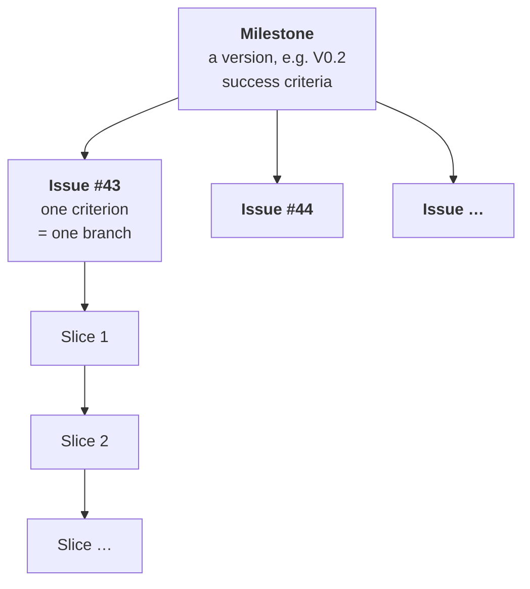
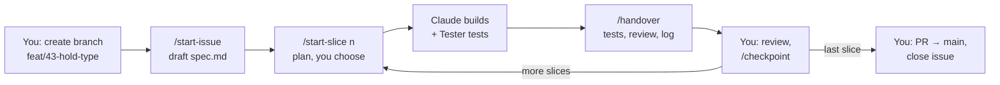

# How we plan and document work

Work is planned at three levels:



| Level | Lives in | Answers |
|---|---|---|
| **Milestone** | GitHub milestone + `docs/milestones/<version>/milestone.md` | What are we building, in what order, and what's blocked? |
| **Issue** | GitHub issue + `docs/milestones/<version>/<n>-<slug>/spec.md` | What does done look like for this one criterion? |
| **Slice** | `docs/milestones/<version>/<n>-<slug>/handover.md` | What happened last session, and what's next? |

## Where things live

```
docs/milestones/
  _templates/                    spec.md and handover.md to copy
  v0.2/
    milestone.md                 criteria, issue table, order, needs-from-you
    43-hold-type/                active issue; folder = branch name without the type
      spec.md                    the contract: goal, done-when, slices, decisions
      handover.md                status table + slice log (newest first)
    completed/
      35-backend-folders/        finished issues move here, docs unchanged
docs/features_deprecated/        finished features from before this workflow
```

**Why spec and handover are separate:** the Tester writes tests from `spec.md` alone. The handover is full of implementation details, and keeping it apart stops them leaking into the tests.

## Branches

**Branch name:** `<type>/<issue>-<slug>`, e.g. `feat/43-hold-type`.
- **Types:** `feat`, `fix`, `refactor`, `docs`, `chore`, `test`.
- **Slug:** lower case words joined with hyphens.
- **Issue folder:** the same slug under the milestone, e.g. `docs/milestones/v0.2/43-hold-type/`.

You create branches. Claude reads the issue number from the branch name, so it never has to ask which issue is active. The hook `.claude/hooks/branch_guard.mjs` won't let Claude edit files on `main` or on a branch with no issue number.

## The loop



1. **Start an issue.** Create the branch, then run `/start-issue`. Claude drafts `spec.md` from the GitHub issue and the milestone, creates `handover.md`, and stops for your approval.
2. **Each slice.**
   - `/start-slice <n>`: Claude plans the slice and you choose an approach.
   - Claude builds the slice.
   - `/handover`: runs tests, the accuracy checks and a review, then writes the log entry.
   - You review, then run `/checkpoint` to commit and push.
3. **Finish an issue.** On the last slice, `/handover`:
   - updates the held docs
   - marks the issue ✅ in `milestone.md`
   - moves its folder into `completed/`

   You open the PR to `main`; `Closes #<n>` closes the issue when it merges.
4. **Finish a milestone.** Archive or keep the milestone folder, close the GitHub milestone, and start `docs/milestones/<next>/milestone.md`.

## Rules of thumb
- **Status goes in one place per level.** The milestone table holds issue status, and each issue's `handover.md` holds slice status. The GitHub issue holds no running status.
- **Decisions go at the lowest level they affect.** A choice for one issue goes in that issue's `spec.md` → *Decisions*. A choice that crosses issues goes in `milestone.md`. A project-wide one goes in `docs/decisions.md` at milestone end.
- **A blocked issue keeps its place in the order.** Mark it ⏸ in `milestone.md` with what it waits on, and move to the next issue.
