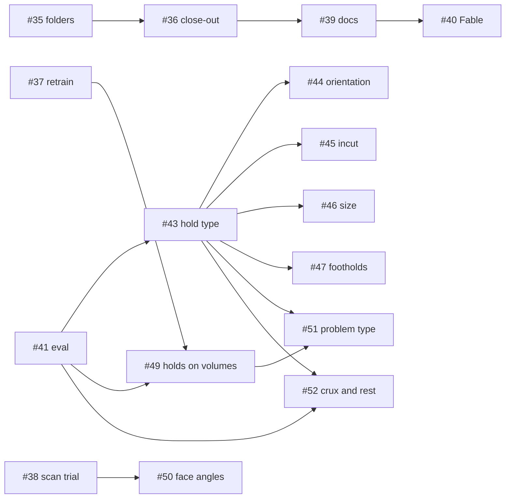

# Milestone V0.2: coaching enrichment

GitHub: [milestone V0.2](https://github.com/TheSamStewart/ML-AI-Rock-Climbing-Assistant/milestone/2) · Started 2026-11-26

Status of each issue, the order of work, and what needs the human. Each issue's own docs are in its folder here (`<n>-<slug>/spec.md`, `handover.md`). A finished issue's folder moves to `completed/<n>-<slug>/`. This file changes when an issue starts, finishes or gets blocked, not after every slice.

## Goal

By the end of this milestone, the coaching AI gets richer climbing data and the user gets clearer, more visual output.

**Already in the prompt (baseline, from the wall size / hold distance feature):**
- the route: the picked holds in order and roughly where each one is
- distances between holds in cm, and the wall's height
- the wall's steepness at each hold, and where it changes during a move
- each move as how far up and how far across it goes
- the climber's height and arm span (if entered), their level and any injuries
- how accurate each measurement is
- how to coach: friendly, plain language, one move per step with a reason, never invent holds

**New in this milestone:** one issue per criterion, listed in the table below.

## Issues

| # | Issue | Branch | Depends on | Status |
|---|---|---|---|---|
| **Phase 0: finish what's in flight** |||||
| [#35](https://github.com/TheSamStewart/ML-AI-Rock-Climbing-Assistant/issues/35) | Backend folder layout | `refactor/35-backend-folders` | | ✅ Done (docs in `completed/35-backend-folders/`) |
| [#36](https://github.com/TheSamStewart/ML-AI-Rock-Climbing-Assistant/issues/36) | Wall measurement close-out (old slice 16) | `feat/36-wall-measurement-closeout` | | ⏳ Waiting on you |
| [#37](https://github.com/TheSamStewart/ML-AI-Rock-Climbing-Assistant/issues/37) | Volume retrain | `feat/37-volume-retrain` | | ⏳ Waiting on you |
| [#38](https://github.com/TheSamStewart/ML-AI-Rock-Climbing-Assistant/issues/38) | Volume scan gym trial | `feat/38-volume-scan-trial` | | ▶ In progress (trial 1 no-go 2026-11-27; improving the scan) |
| [#39](https://github.com/TheSamStewart/ML-AI-Rock-Climbing-Assistant/issues/39) | Wall measurement docs write-up (old slice 17) | `docs/39-wall-measurement-docs` | #36 | ☐ To do |
| [#40](https://github.com/TheSamStewart/ML-AI-Rock-Climbing-Assistant/issues/40) | Fable review (old slice 18) | `chore/40-fable-review` | #39 | ☐ To do |
| **Phase 1: measure first** |||||
| [#41](https://github.com/TheSamStewart/ML-AI-Rock-Climbing-Assistant/issues/41) | Coaching-quality eval | `feat/41-coaching-eval` | | ☐ To do |
| [#42](https://github.com/TheSamStewart/ML-AI-Rock-Climbing-Assistant/issues/42) | Feedback button per step | `feat/42-step-feedback` | | ☐ To do |
| **Phase 2: hold data** |||||
| [#43](https://github.com/TheSamStewart/ML-AI-Rock-Climbing-Assistant/issues/43) | Hold classification | `feat/43-hold-type` | #41 | ☐ To do |
| [#44](https://github.com/TheSamStewart/ML-AI-Rock-Climbing-Assistant/issues/44) | Hold orientation | `feat/44-hold-orientation` | #43 | ☐ To do |
| [#45](https://github.com/TheSamStewart/ML-AI-Rock-Climbing-Assistant/issues/45) | Positive / incut | `feat/45-hold-incut` | #43 | ☐ To do |
| [#46](https://github.com/TheSamStewart/ML-AI-Rock-Climbing-Assistant/issues/46) | Hold size and shape | `feat/46-hold-size-shape` | #43 | ☐ To do |
| [#47](https://github.com/TheSamStewart/ML-AI-Rock-Climbing-Assistant/issues/47) | Foothold identification | `feat/47-footholds` | #43 | ☐ To do |
| [#48](https://github.com/TheSamStewart/ML-AI-Rock-Climbing-Assistant/issues/48) | Reachability check | `feat/48-reachability-check` | | ☐ To do |
| **Phase 3: volumes** |||||
| [#49](https://github.com/TheSamStewart/ML-AI-Rock-Climbing-Assistant/issues/49) | Holds on volumes (old slices 14, 15 part 1) | `feat/49-holds-on-volumes` | #37, #41 | ⏸ Blocked |
| [#50](https://github.com/TheSamStewart/ML-AI-Rock-Climbing-Assistant/issues/50) | Volume face angles | `feat/50-volume-face-angles` | #38 | ⏸ Blocked |
| **Phase 4: derived data and output** |||||
| [#51](https://github.com/TheSamStewart/ML-AI-Rock-Climbing-Assistant/issues/51) | Problem type | `feat/51-problem-type` | #43, #49 | ☐ To do |
| [#52](https://github.com/TheSamStewart/ML-AI-Rock-Climbing-Assistant/issues/52) | Crux and rest | `feat/52-crux-and-rest` | #41, #43 | ☐ To do |
| [#53](https://github.com/TheSamStewart/ML-AI-Rock-Climbing-Assistant/issues/53) | Visual step-through | `feat/53-visual-step-through` | | ☐ To do |
| **Bugs** |||||
| [#55](https://github.com/TheSamStewart/ML-AI-Rock-Climbing-Assistant/issues/55) | Whole-wall switch: only allow flips that will be applied | `fix/55-whole-wall-switch` | | ▶ In progress (agent, PR pending) |

Status key: ▶ In progress · ☐ To do · ⏳ Waiting on you · ⏸ Blocked · ✅ Done

**Why this order:**
- **The eval (#41) comes before any prompt enrichment.** Each enrichment's done-when includes "the eval score doesn't drop", so the eval has to exist first.
- **Hold type (#43) builds the classifier.** #44–#47 probably extend the same call instead of adding new ones.
- **#37 needs your data, and #38 your gym trials,** so they run alongside the other code work. #38 also has code slices of its own (4–7c) between trials.
- **The Fable review (#40) includes the coaching prompt.** If you'd rather its prompt changes were scored, move it after #41.
- #42 (feedback) and #53 (visual) don't depend on anything, so start them whenever suits.

## Needs from you
1. **#36:** check the bolt-pattern Settings screen on a phone, and take slab photos. Record the wall angle, a few tape distances and the phone tilt for each.
2. **#37:** correct both label sets in Roboflow (steps 3 and 6), then train on Colab (step 9).
3. **#38:** the go thresholds for face angles, then gym trial 2 once the scan is improved (trial 1, 2026-11-27, was a no-go).
4. **#41 (when it starts):** about 10 field captures with beta you wrote or approved, and sign-off on the rubric.

## Decisions (across issues)
- 2026-11-26: workflow is milestone → one GitHub issue per criterion → one branch per issue (`<type>/<n>-<slug>`) → slices. See `docs/docs.md`.
- 2026-11-26: `architecture.md`, `testing.md`, `decisions.md` and `measurements.md` are held until the current **issue** is complete (was: feature), then updated in its last slice.

## Parked plans (read before starting the matching issue)

### Hold type (#43, and probably #44–#47): discussed 2026-11-24

**Why not retrain YOLO:** you tried hold types as YOLO classes originally, and the model got easily confused (it has to find holds *and* sort them at once). YOLO already finds the holds, so naming them is a separate, easier job for a vision model.

**Option A (recommended first):** give the existing coaching call the photo with the picked holds numbered on it (like `field_captures/*/overlay_1.jpg`), plus close-up crops of each picked hold from the full-resolution photo. The prompt asks the coaching model to work out each hold's type.
- No new pipeline step, and under 1p per analysis for the extra image.
- Best context: whether a hold is a foothold or a handhold depends on the route and the climber, not the hold alone, and the coaching model already has the route, distances and angles.
- Downside: the types live only inside the coaching answer, so the app can't show them and we can't measure them.

**Option B (if types are wanted in the app or measured):** a separate classifier call before coaching.
- Use Claude Haiku 5.5 ($0.10 / $0.50 per million tokens; about 0.1p per photo). Sonnet 5.5 would be about 2p.
- One request per photo, with the numbered image plus crops.
- Structured outputs (`output_config.format`, JSON schema) with the type as a fixed list: crimp, jug, sloper, pinch, pocket, edge, volume, other; plus a size.
- The result goes into the worker payload like the other fields.

**Needed either way:**
- **Keep the photo.** The server drops it after `/detect` (only detections and scale are cached in Redis). Either cache it, or a downscaled copy plus crops, for the same 1 hour, or have the app send it again.
- **Send crops of the picked holds.** In a full-wall image shrunk to about 1,500 px, a small crimp is only 20–30 px.
- **Run an eval before trusting it.** You label the hold types on about 10 field captures. Compare Haiku and Sonnet on them, and option A's answers too. Only pick Haiku if it holds up.
- **Read the `claude-api` skill before writing the calls,** for current model ids, structured outputs and image inputs.

Since #43 now needs measured accuracy and the eval, **option B fits the new criteria better**. Decide at `/start-slice` on that issue.
